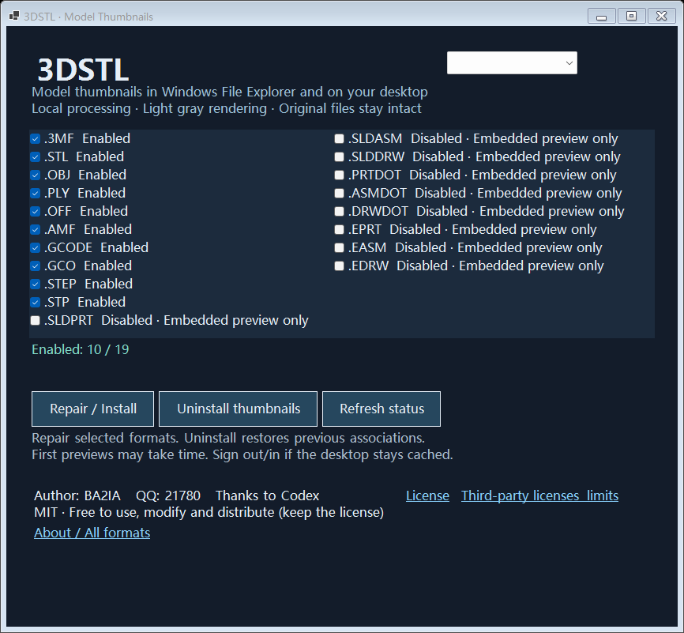

# 3DSTL

**Free Windows model thumbnails · 中文 / English · MIT-licensed original source**

View models directly in File Explorer and on your desktop. Includes light gray rendering, Repair/Install, previous-association recovery and a bilingual manager.

**Author: BA2IA · QQ: 21780 · Thanks to Codex**

[Download](https://github.com/Wastrix-ba2ia/3DSTL/releases/latest) · [中文](README.md) · [MIT License](LICENSE)



## Installation

Download `3DSTL-0.1.0-win-x64.zip` from Releases and extract the entire archive. Run **安装-Install.exe**, select English and click Install. A desktop shortcut is created. Windows 10/11 x64 is required. The bundle includes a portable Python/CAD runtime and Microsoft's signed .NET 8 Desktop Runtime installer. Original project binaries are currently unsigned.

## All supported extensions

| Extensions | Support |
|---|---|
| `.stl` | Binary / ASCII mesh rendering |
| `.3mf` | Multi-part geometry and component transforms; embedded-image fallback |
| `.obj` | Mesh rendering, negative indices; uniform material, no external textures |
| `.ply` | ASCII / binary mesh rendering |
| `.off` | Mesh rendering |
| `.amf` | XML / zipped AMF; basic objects and instance transforms |
| `.gcode`, `.gco` | Embedded PNG/JPEG or linear G0/G1 extrusion-path preview |
| `.step`, `.stp` | Open CASCADE geometry tessellation |
| `.sldprt`, `.sldasm`, `.slddrw` | Embedded previews only |
| `.prtdot`, `.asmdot`, `.drwdot` | Embedded previews only |
| `.eprt`, `.easm`, `.edrw` | Readable embedded bitmap previews only |

The final nine extensions do **not** have full proprietary geometry support. Files without compatible previews may fail. Compatibility has not been verified against genuine SOLIDWORKS/eDrawings samples. Existing official handlers are best kept unless you explicitly choose to replace them.

## Features and limits

- Local processing; no model uploads, API keys or subscription.
- Chinese / English interface with persisted language choice.
- Repair selected formats; uninstall restores previous associations without changing model files or default applications.
- Recovery information stays in `%LOCALAPPDATA%/3DSTL/associations.json` and is excluded from public downloads.
- Uninstall removes thumbnail integration; application files and backups remain for recovery.
- Input cap: 128 MiB; mesh cap: 1.5 million triangles; converter timeout: 25 seconds.
- G2/G3 arcs, BGCODE, external textures and advanced AMF extensions are not fully supported.
- Preview shadows are illustrative, not physically traced.
- This release uses an in-process COM handler. Heavy models or runtime failures can still affect Explorer despite conversion time limits.

## Build

Requires Windows x64, .NET 8 SDK and Python 3.12.

```powershell
./scripts/Build.ps1
./scripts/Prepare-Runtime.ps1 -Python python
```

Sources: `src/`. Tests: `tests/`. Output: `artifacts/`. Manager `--selftest` verifies registration and recovery in a temporary registry branch.

## License

Original source: **MIT**. Free use, modification, redistribution and commercial use are permitted with copyright/license notices retained. Provided as-is.

Dependencies retain their own licenses; Open CASCADE uses LGPL with its exception. See [third-party notices](THIRD-PARTY-NOTICES.txt).