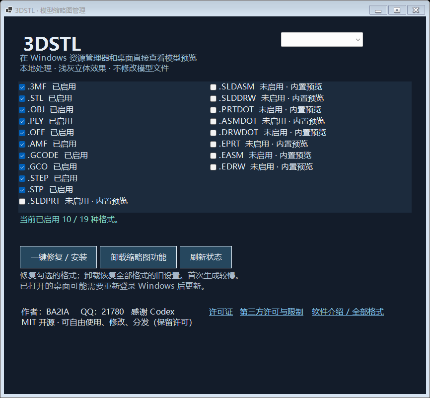

# 3DSTL

本项目拥有独立源码、Git 仓库和构建流程，不依赖副屏软件或旧的 3MF 试验目录。目录说明见 [项目结构](docs/PROJECT.md)。

**免费 Windows 模型缩略图工具 · 中文 / English · MIT 开源**

在资源管理器和桌面直接查看模型缩略图，不必逐个打开切片软件。采用浅灰背景、立体光照，支持一键安装/修复和恢复原设置。

**作者：BA2IA · QQ：21780 · 感谢 Codex**

[下载最新版](https://github.com/Wastrix-ba2ia/3DSTL/releases/latest) · [English](README.en.md) · [安装指南](docs/INSTALL.md) · [MIT 许可证](LICENSE)



## 下载与安装

1. 从 Releases 下载 `3DSTL-0.1.3-win-x64.zip`，完整解压。
2. 双击 **安装-Install.exe**，选择中文或 English，点击安装。
3. 安装到当前用户目录，桌面会生成 **3DSTL** 快捷方式。
4. 打开文件夹，切换到大图标或超大图标；首次生成需要时间。

Windows 10/11 x64。完整包包含独立 Python/CAD 转换组件和微软签名的 .NET 8 Desktop Runtime 安装程序；缺少运行时会提示安装。未签名的本项目程序可能出现未知发布者提示。

## 在线更新

`0.1.1` 起，传统版启动时每天自动检查一次本仓库的正式 GitHub Release，有新版时在后台下载并校验 SHA256。下载完成后点击 **安装更新**，程序保留旧版、语言设置及关联恢复备份，安装到独立版本目录并更新桌面快捷方式。界面底部可关闭“自动检查并下载更新”，也可手动“检查更新”或打开“GitHub 项目主页”。

`0.1.0` 没有在线更新功能，需要先手动下载安装一次 `0.1.1`。商店版继续通过 Microsoft Store 更新。旧缩略图组件如果仍被 Explorer 占用，重新登录 Windows 后完全切换到新版。

## 全部格式

| 格式 | 支持方式 |
|---|---|
| **.stl** | 二进制、文本 STL 模型渲染 |
| **.3mf** | 多零件/组件变换模型渲染；复杂文件尝试内置预览 |
| **.obj** | 网格渲染，包括负索引；统一材质，不加载外部贴图 |
| **.ply** | 文本与二进制网格渲染 |
| **.off** | 网格渲染 |
| **.amf** | XML/压缩 AMF；基础对象与实例变换，不支持全部扩展 |
| **.gcode、.gco** | 内置 PNG/JPEG 预览；无图时显示 G0/G1 挤出路径 |
| **.step、.stp** | Open CASCADE 实体三角化后渲染 |
| **.sldprt** | SOLIDWORKS 零件：仅尝试内置预览 |
| **.sldasm** | SOLIDWORKS 装配：仅尝试内置预览 |
| **.slddrw** | SOLIDWORKS 图纸：仅尝试内置预览 |
| **.prtdot** | SOLIDWORKS 零件模板：仅尝试内置预览 |
| **.asmdot** | SOLIDWORKS 装配模板：仅尝试内置预览 |
| **.drwdot** | SOLIDWORKS 图纸模板：仅尝试内置预览 |
| **.eprt、.easm、.edrw** | eDrawings：仅尝试可读取的内置位图 |

**后九种格式并非完整专有几何解析器。** 无内置图片、加密、不兼容版本可能无法预览；尚无真实 SOLIDWORKS/eDrawings 样本的完整兼容性验证。建议保留已有的官方缩略图处理器，需要替换时手动勾选。

## 功能

- 中英文切换并记住语言。
- 一键修复/安装勾选格式。
- 卸载缩略图功能，恢复安装前的关联；不修改模型和默认打开程序。
- 全部在本机处理，无需上传模型、API 密钥或付费订阅。
- 原设置备份保存在 `%LOCALAPPDATA%/3DSTL/associations.json`，不随公开包发布。

卸载按钮卸载的是**缩略图功能**。为方便恢复，程序文件与备份保留；完整移除步骤见安装指南。

## 限制

旧版 `0.1.0` 包输入上限为 128 MiB、150 万三角面、转换最长 25 秒。`0.1.1` 已支持大 STL（含二进制和文本）：输入上限 1 GiB，完整扫描模型并生成最多 40 万面的减量缩略图；原文件不变。安装/修复后，桌面刷新队列先处理普通模型，再低优先级逐个处理超过 150 万面的二进制 STL 或超过 75 MiB 的文本 STL。大 STL 渲染最多等待 180 秒。其他格式限制保持原样。大型/损坏/特殊格式文件可能无法生成。G2/G3 弧线、BGCODE、外部纹理、AMF 高级扩展尚未完整支持。阴影是预览用的柔和示意阴影，不是物理光线追踪。

缩略图通过当前用户 COM 注册加载；此版使用进程内处理器。虽然转换进程有时间限制，复杂模型的内存/运行时异常仍可能影响 Explorer。大型模型支持会继续改进。

## 构建与验证

需要 Windows x64、.NET 8 SDK、Python 3.12：

```powershell
./scripts/Build.ps1
./scripts/Prepare-Runtime.ps1 -Python python
```

源码位于 `src/`，测试位于 `tests/`，生成文件位于 `artifacts/`。管理器 `--selftest` 在临时注册表分支验证安装、重复修复和卸载恢复，不卸载真实关联。公开格式使用生成样本及实际 STL/STEP/3MF 验证；专有格式当前只验证提取逻辑。

## 开源许可

原创代码采用 **MIT**：可自由使用、修改、分发及商业使用，须保留版权与许可证。软件按现状提供，不附保证。

第三方组件遵循各自许可证，包括 Open CASCADE 的 LGPL 及例外条款，不全部属于 MIT。请阅读 [第三方声明](THIRD-PARTY-NOTICES.txt)。

### 0.1.2 大 3MF 与自动摆正

3MF 支持 512 MiB 压缩输入、单个 1 GiB 模型 XML，流式读取；超过150万面的单个网格生成简化灰色预览。较大3MF在桌面刷新队列末尾处理。方向明确的细长单体自动尝试尖端向上；方向不明、圆形和多零件保留原方向。原文件不变，内置备用图片不旋转；首次读取仍可能较慢，超出安全预算仍可退回备用图片。详见 [大模型说明](docs/LARGE-MODELS.md)。

### 0.1.3 应用内图片预览

点击“打开模型预览”，再打开或拖入本地文件，或点击“查看示例”。也可向3DSTL.exe传入文件路径。预览由独立进程生成，支持中英文、加载和错误提示、取消及超时；原模型不变。不提供交互式3D旋转或编辑。此版本保留传统版修复/恢复关联和GitHub在线更新。商店版版本号独立（0.2.2.0）。
